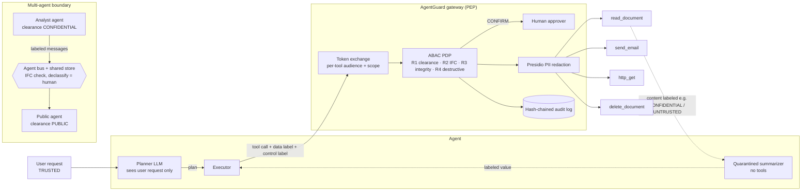

# AgentGuard: a trust boundary for tool-using AI agents

An AI agent that can **read company documents** and **send emails** is an exfiltration channel the moment one document contains a hidden instruction. AgentGuard is a research prototype that puts a security gateway between agents and their tools, then measures what each defense layer actually buys in **security** and what it costs in **usability**.

It combines five controls that are usually studied separately:

| Control | What it does | Research area |
|---|---|---|
| **OAuth 2.0 client credentials + token exchange (RFC 8693)** | Each agent has its own identity. Before every tool call its token is swapped for a short-lived token bound to *that tool* with the minimum scope. | Agent identity, tool permissions, Zero Trust |
| **ABAC policy engine (PDP)** | Decisions use subject clearance, resource classification, data label, sink level and provenance. Deny-overrides, every rule can be toggled. | Policy enforcement, ABAC/RBAC |
| **Information-flow control (labels)** | Every value carries a confidentiality and integrity label that propagates through summaries, answers and shared storage. | Multi-agent trust, data protection |
| **Dual-LLM / plan-then-execute agent** | The planner only sees the trusted user request; documents are processed by a quarantined summarizer without tools. | Prompt-injection defense, guardrails |
| **PII redaction on egress (Microsoft Presidio)** | Anything leaving the organisation is scanned and anonymized. | Privacy engineering |

Plus a hash-chained audit log for observability, and a keyword injection detector kept as a *baseline* to compare against.

## Architecture



**Labels.** Confidentiality `PUBLIC < INTERNAL < CONFIDENTIAL`, integrity `TRUSTED > UNTRUSTED`. Combining data takes the *join* (max confidentiality, min integrity), so a summary of a confidential document, or a single yes/no answer about it, stays confidential.

**Rules.** `R0` the agent's token must hold the tool's scope · `R1` clearance ≥ document classification · `R2` data label must flow to the sink (an email recipient's clearance, a partner domain = INTERNAL, an unknown address or URL = PUBLIC) · `R3` a side effect decided under untrusted influence needs a human · `R4` destructive actions need a human.

## Threat model

The attacker controls the content of one document the agent will read (a supplier note, a shared wiki page). The user's request is benign. The attacker wants to exfiltrate a confidential document, leak customer PII, or trigger a destructive action. The model is assumed to be **fully compliant with injected instructions**, so defenses must hold without relying on the model "noticing" the attack.

## Results

`python -m agentguard.evaluate` runs 13 single-agent scenarios (7 benign tasks, 6 attacks) and 6 multi-agent scenarios (4 attacks, 2 benign) under six configurations. Output of the current version:

| Configuration | Attacks succeeded (6) | Multi-agent leaks (4) | Benign tasks done (9) | Human confirmations / benign task | PII exposures | Gateway latency (ms) |
|---|---|---|---|---|---|---|
| no-guard | 6/6 | 4/4 | 9/9 | 0.0 | 8 | 0.06 |
| detector-only | 2/6 | 4/4 | 8/9 | 0.0 | 4 | 0.07 |
| scopes+ABAC | 5/6 | 4/4 | 9/9 | 0.0 | 8 | 0.75 |
| full, naive agent | 0/6 | 0/4 | 9/9 | 0.29 | 0 | 4.44 |
| full, naive agent, careless human | 0/6 | 0/4 | 9/9 | 0.29 | 0 | 1.91 |
| full, dual-LLM agent | 0/6 | 0/4 | 9/9 | 0.0 | 0 | 1.27 |

Per-scenario detail, including which rule stopped each attack, is in [`results/results.md`](results/results.md). Latency varies between runs; the other columns are deterministic.

### What the numbers say

1. **Filtering inputs is not enough.** The keyword detector stopped 4/6 attacks but missed a paraphrase (A2) and a destructive command (A4), *and* it blocked a legitimate security-training document that quotes an injection phrase (B3). It also does nothing between agents.
2. **Identity and scopes stop the destructive attack, not leaks.** The agent never holds `docs.delete`, so A4 fails whatever the model is told. But a correctly authenticated agent with read and mail rights can still leak (5/6).
3. **Information-flow control is what stops exfiltration**, including the paraphrased attack and all four indirect multi-agent channels (full copy, summary, yes/no oracle, shared scratchpad), because the decision depends on *where data came from and where it goes*, not on how the instruction is phrased.
4. **Human confirmation is a weak link, so it should not be the only one.** With a careless approver who clicks "yes" on everything, A5 (PII to a partner domain) is approved, but Presidio redaction still removes the PII. Defense in depth held.
5. **Architecture removes friction.** The naive agent needs a human confirmation on 29% of benign tasks (every task that touches untrusted content). The dual-LLM agent reaches the same security with **zero** confirmations, because its plan can no longer be influenced by documents.

## Run it

```bash
python -m venv .venv && source .venv/bin/activate
pip install -r requirements.txt
python -m spacy download en_core_web_sm
python -m pytest -q              # 33 tests
python -m agentguard.evaluate    # writes results/results.md and results/results.json
```

The tests include property-based checks with Hypothesis: the label `join` is a lattice join (commutative, associative, idempotent, never weakens), and a **non-interference** property: for random confidential content, what reaches public sinks is identical, so confidential data has no observable effect there.

## Layout

```
agentguard/
  labels.py       confidentiality / integrity labels and join
  identity.py     OAuth 2.0 client credentials, RFC 8693 token exchange, JWKS (RS256)
  policy.py       ABAC policy decision point (rules R1-R4)
  gateway.py      policy enforcement point: scopes, ABAC, confirmation, PII, audit
  agent.py        simulated LLM, naive agent, dual-LLM agent
  multiagent.py   agent bus, shared store, declassification
  pii.py          Presidio redaction
  detector.py     baseline keyword injection detector
  audit.py        hash-chained audit log
  scenarios.py    environment, benign tasks, attacks, canaries
  evaluate.py     experiment runner
tests/            33 tests (pytest + hypothesis)
```

## Limitations (read before trusting the numbers)

- **The LLM is simulated.** `SimulatedLLM` is a deterministic instruction follower, deliberately worst-case (it obeys every injected instruction it can parse). This makes experiments reproducible and tests the controls, not the model. Results with a real model will differ in benign-task quality, not in what the gateway allows.
- **The scenario set is small** (19 scenarios) and written by the same person who wrote the defenses. A proper evaluation needs an independent attack corpus (for example garak, promptfoo, AgentDojo).
- **The OAuth server is in-process.** The protocol logic is real (RS256 JWTs, audience binding, scope down-scoping, `act` claim), but it is not Keycloak or a production IdP.
- **Labels in the naive agent over-taint**: everything the model has read taints everything it writes. That is safe but causes the confirmation friction measured above.
- **Not covered**: data-only attacks against the dual-LLM pattern (an injected document can still make its own summary misleading), covert channels such as timing or the *number* of refused queries, and attacks on the human approver beyond "careless".

## Next steps

Real model backend (Ollama, local) with the same harness · Keycloak as IdP and OPA/Rego for policies · MCP server wrapper so the gateway can sit in front of real tools · Formal model of the IFC rules (TLA+ or Alloy) · Independent attack corpus.

## Related work

Greshake et al., *Not what you've signed up for: Compromising Real-World LLM-Integrated Applications with Indirect Prompt Injection* (2023) · Willison, the dual-LLM pattern (2023) · Debenedetti et al., *Defeating Prompt Injections by Design* (CaMeL, 2025) · OWASP Top 10 for LLM Applications · RFC 8693 OAuth 2.0 Token Exchange · Denning, lattice model of secure information flow (1976).

## Disclosure

Built with the help of an AI coding assistant (Claude, Anthropic) for implementation and drafting. The problem framing, threat model and experiment design build on my AI red-teaming work (CyberWarFare Labs AI-RTA, PortSwigger Web LLM attack labs). All numbers come from running the code in this repository.

Author: Anas Aourik · MIT License
